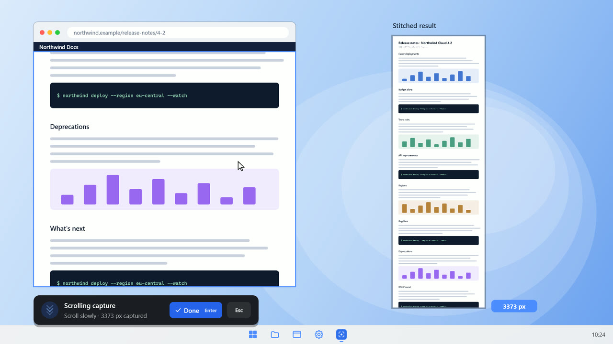
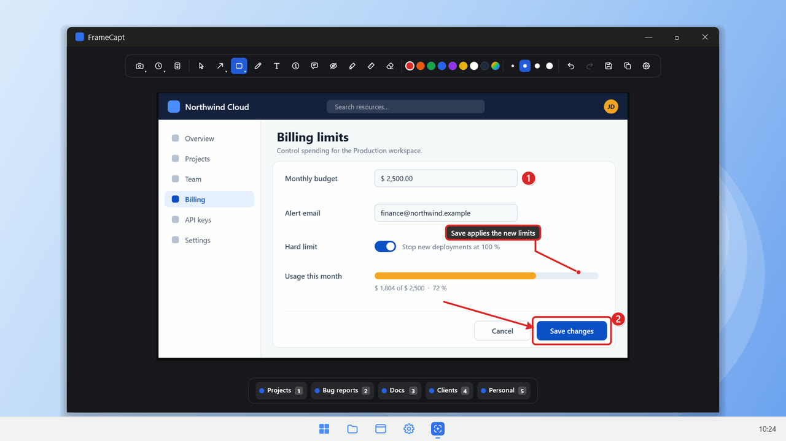
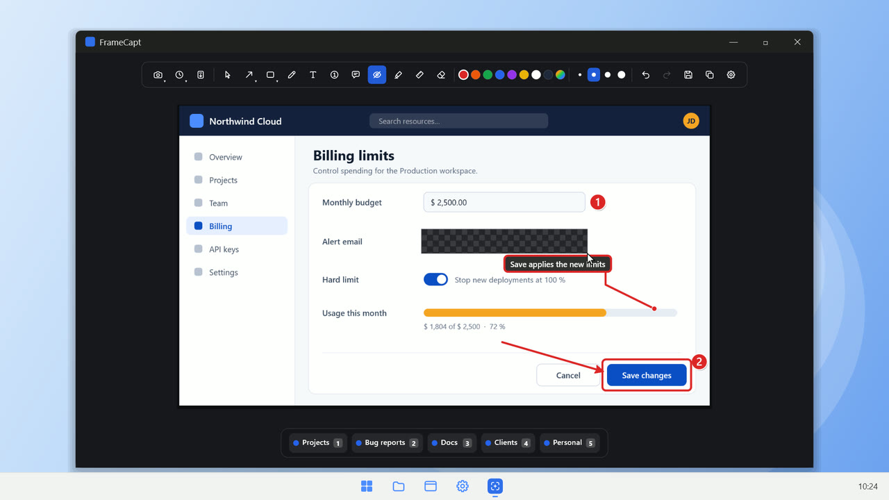
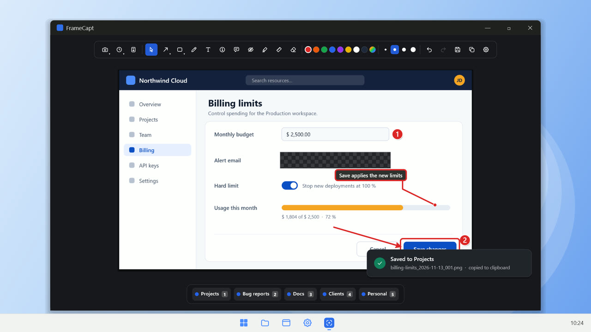
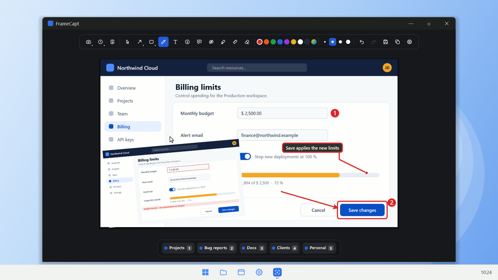
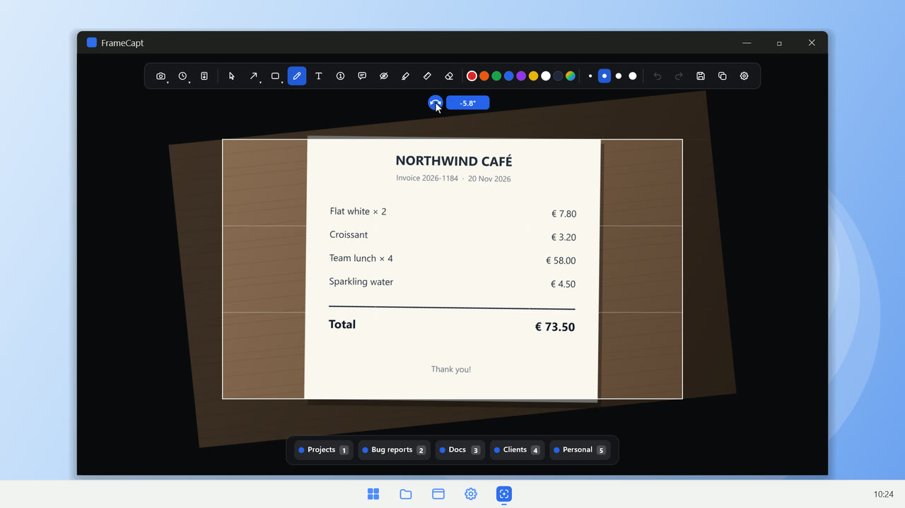

# FrameCapt

Clear, consistent screenshots for your whole team – a native screenshot and annotation tool for
Windows 10 and 11. Capture a region, a window, the full screen or a whole **scrolling page**, add arrows,
numbered steps, callouts and privacy masks, and save into the right folder with one key.
Everything stays on your PC – no cloud, no account.

**Website:** [www.framecapt.com](https://www.framecapt.com) · **Support:** support@framecapt.com

This repository contains the public releases and the list of changes. The source code is not public.

| | |
| --- | --- |
|  **Scrolling capture** – a whole page in one image |  **Step-by-step guides** – numbered steps, callouts, arrows |
|  **Privacy masks** – hidden permanently in the saved file |  **One-key save** – up to 10 folders |
|  **Combine captures** – compare before and after |  **Straighten** – fix a crooked photo with one drag |

## Download

| | |
| --- | --- |
| **Microsoft Store** (recommended) | [Get FrameCapt](https://apps.microsoft.com/detail/9NGWMW4C9QJM) – signed by Microsoft, updates automatically |
| **Installer (.exe)** | [Latest release](https://github.com/MiroslavDivis/FrameCapt-releases/releases/latest) – per user, no admin rights; compare the SHA-256 in the release notes |

The installer is signed with our own certificate, so Windows SmartScreen may show a warning;
the Microsoft Store version does not.

## Rollout in companies

- **Microsoft Intune:** Apps → Windows → Add → *Microsoft Store app (new)* → search for *FrameCapt*
  (Store ID `9NGWMW4C9QJM`). Intune installs and updates it on every device.
- **winget:** `winget install --id 9NGWMW4C9QJM --source msstore`
- **Installer:** `FrameCapt-Setup.exe /VERYSILENT`
- **Licence:** enter the Enterprise key once per computer in Settings → Licence. Free 30-day team trial:
  [www.framecapt.com/trial](https://www.framecapt.com/trial)

## What's new

See [CHANGELOG.md](CHANGELOG.md).

## Bugs and ideas

Open an [issue](https://github.com/MiroslavDivis/FrameCapt-releases/issues) or write to support@framecapt.com.
Please never attach screenshots that contain personal or confidential data.

---

© 2026 Miroslav Diviš. All rights reserved. FrameCapt is proprietary software; use is governed by the
[licence terms](https://www.framecapt.com/terms). The Free edition is for personal use and evaluation.
